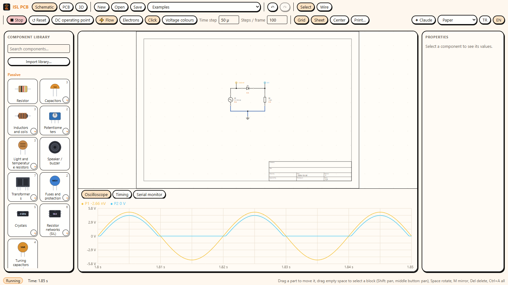
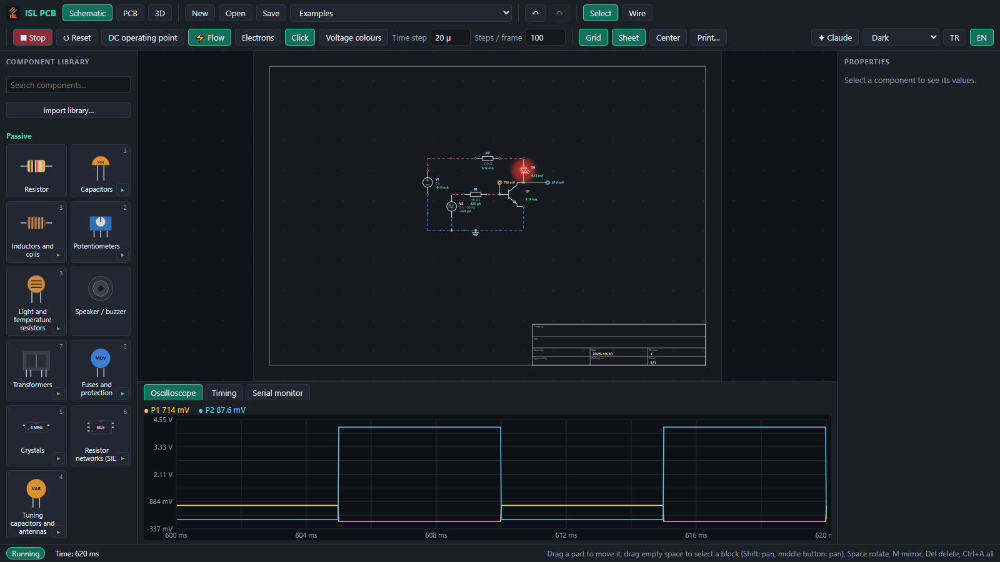
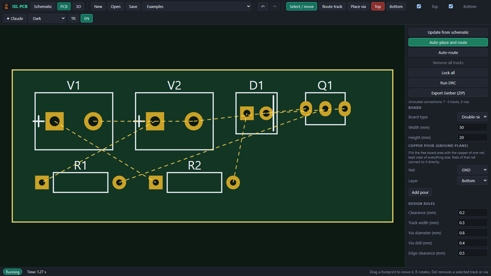

<div align="center">


# ISL PCB

**Schematic capture, circuit and Arduino simulation, and PCB design in one desktop app.**

Draw a circuit, press **Run**, and watch the current flow, the LEDs light and the microcontroller code execute.
Then turn the same schematic into a routed board and export Gerber files.

</div>



## Highlights

- **Schematic editor** with a snapping grid, orthogonal wires, rotate / mirror, block selection, undo / redo, a drawing
  sheet with title block, printing and PDF export.
- **Circuit simulator** (modified nodal analysis, DC operating point and transient) with resistors, capacitors,
  inductors, sources, diodes, bipolar and MOSFET transistors, op-amps, thyristors and switches. Parts carry
  datasheet-fitted models and **warning badges** when a rating (voltage, current, power, polarity) is exceeded.
- **Live view of what the circuit does** (the *Flow* toolbar group):
  - wires turn **red where they are live** and **blue on the 0 V side**; dashes run along them **in the direction of the
    current** (or of the electrons) and speed up with the current;
  - **ON badges** on closed switches, lit lamps, pulled-in relays and running motors;
  - a **single click flips a switch**, push buttons close while held;
  - select a part and a card explains **why it is on or off** (voltage across it, current, an open switch in the way,
    reversed polarity ...);
  - a **Timing** tab draws the ON / OFF history of switches, LEDs, lamps and relays like a logic analyser.
- **Microcontrollers that run real firmware**: Arduino Uno / Nano / Mega (ATmega328P and ATmega2560 through
  [avr8js](https://github.com/wokwi/avr8js)), Raspberry Pi Pico (RP2040 through
  [rp2040js](https://github.com/wokwi/rp2040js)) and PIC16F84A / 628A / 877A (built-in assembler). The pins drive the
  analog circuit and read it back (LED loads, pull-ups, buttons, PWM).
- **Serial monitor** with input, an optional bridge to a **real COM port**, and a virtual Nextion display.
- **Ready-made examples**: RC filter, rectifier, BJT switch, op-amp amplifier, inverter, FM transmitter, AM radio,
  Arduino blink / fade / analog / serial / Bluetooth / sensor station / ultrasonic driver and more, including
  - a **six-digit 7-segment clock** (HH:MM:SS) driven by an Arduino Nano through a ULN2003, with the digits lit one after the other;
  - a **four-motor Bluetooth car** (Nano, HC-05, two L298N modules), its **remote control**, and the two **talking to each other**;
  - wiring examples for an **nRF24L01** and an **ESP-01** with their 3.3 V supply and level divider.
- **Part library** of about 445 parts defined in plain JSON (see [`library/README.md`](library/README.md)), including
  modules such as HC-05, HC-12, ESP-01, nRF24L01, L298N, TB6612FNG, L293D, TM1637, a 6-digit 7-segment display and many
  sensors, transistors and MOSFETs. You can import your own.
- **PCB design**: update the board from the schematic, auto-place, auto-route, copper pours, design-rule check,
  Gerber / drill export as a ZIP, and a 3D board view.
- **Themes**: light *Paper*, *Linen*, *Stone*, *Sand*, *Mist* and *Fusion 360*; dark *Dark*, *Blender 3D*, *Midnight*,
  *Forest*, *Sunset* and *High contrast*.
- **English and Turkish** user interface.
- **Works with Claude** (optional): an assistant panel can build and inspect circuits, either through your own API key or
  through **Claude Desktop** using the bundled MCP server (no API key needed).

| Dark theme with the oscilloscope | PCB editor |
| --- | --- |
|  |  |

## Getting started

### Run from source

You need [Node.js](https://nodejs.org/) 20 or newer.

```bash
npm install
npm run dev        # the editor in your browser (Vite), hot reload
npm start          # build and open the desktop app (Electron)
npm test           # the test suite
```

### Build a Windows installer

The installer is made with [Inno Setup 6](https://jrsoftware.org/isinfo.php) (install it to the default folder first):

```bash
npm run installer  # packs the app, then runs Inno Setup; the result is installer/output/ISL_PCB_Setup_<version>.exe
```

`npm run pack` alone produces the portable folder `release/ISL_PCB`.

### Compiling Arduino sketches (optional)

The examples ship with precompiled firmware, so they run without any toolchain. To compile your own sketch inside the
app, install the [Arduino IDE 2](https://www.arduino.cc/en/software) (the app finds its `arduino-cli`) or set the
`ARDUINO_CLI` environment variable to an `arduino-cli` executable. You can always load a `.hex` file instead.

## A first circuit in two minutes

1. Pick **Examples → LED** in the toolbar, or place parts from the library on the left (drag, or click a part and click
   the sheet). `R` or `Space` turns a part, `M` mirrors it.
2. Choose the **Wire** tool (`W`) and click from pin to pin. A wire ends when it reaches a pin or another wire.
3. Press **Run**. The wires colour, current moves along them and the LED glows. **Stop** pauses, **Reset** starts over.
4. Click a switch to flip it. Select a part to read why it is on or off.
5. Place a **probe** on a net to plot its voltage in the **Oscilloscope** tab.

The full walkthrough, including microcontrollers and the PCB workflow, is in the **[user guide](docs/USER_GUIDE.md)**.

## Keyboard and mouse

| Action | How |
| --- | --- |
| Place a part | click it in the library, then click the sheet (right click cancels) |
| Wire tool | `W`, click pin to pin, right click finishes |
| Rotate / mirror | `R` or `Space` / `M` |
| Select a block | drag on empty space; left to right takes what is fully inside, right to left what it touches |
| Pan / zoom | middle mouse button or `Shift` + drag / mouse wheel |
| Delete | `Delete` |
| Select all | `Ctrl` + `A` |
| Undo / redo | `Ctrl` + `Z` / `Ctrl` + `Y` |
| Grid on / off | `G` |
| Print or export PDF | `Ctrl` + `P` |

## Project layout

```
core/       simulation and PCB engines without any UI: the solver, the MCU emulators, copper, DRC, Gerber
src/        the React application: schematic editor, panels, PCB editor, 3D view, themes, translations
electron/   the desktop shell: window, splash screen, arduino-cli bridge, Claude Desktop bridge
library/    the part library (JSON), Arduino example sketches with their compiled hex, PIC and RP2040 programs
mcp/        the MCP server that lets Claude Desktop drive the app
scripts/    library generator, example sketch builder, packaging
tests/      the test suite (vitest)
installer/  Inno Setup script and icon
docs/       user guide and images
```

## What is and is not simulated

- Analog parts are real circuits of the solver's primitives, with parameters fitted to datasheets.
  Switching times, reverse recovery, regulator current limiting and temperature are **not** simulated.
- Digital **protocol modules** (Wi-Fi, nRF24, displays with I²C or SPI, GPS, RFID ...) are *pinout only*: they have a
  symbol, a footprint and a supply load, and the sketch cannot talk to them. The exceptions are the Nextion display and
  the serial radios **HC-05, HC-06 and HC-12**: give two of them the same *link* name and the boards behind them exchange
  what they print on their serial ports. With several boards the serial monitor writes each board's lines whole, in front of
  them the board's reference (`[A1] ...`).
- Serial pairing works for boards on the hardware serial port (D0 / D1).

## Status

ISL PCB is under active development and Windows is the tested platform. Bug reports and ideas are welcome as issues.

## Credits and data

- Emulation: [avr8js](https://github.com/wokwi/avr8js) and [rp2040js](https://github.com/wokwi/rp2040js) by Wokwi (MIT);
  3D view: [three.js](https://threejs.org/); built with React, Vite and Electron.
- Relay, power and module footprints follow the makers' drawings; the relay hole positions are those of the KiCad
  library footprints of the same relays (CC-BY-SA 4.0).
- Many part models were fitted to datasheet values (see `scripts/library_direnc.py` for what is modelled and what is not).

## License

No license has been chosen yet. Until one is added to this repository, all rights are reserved by the author.
